# Agent Skills: responsive design + website localization

Two [Agent Skills](https://docs.claude.com/en/docs/claude-code/skills) for Claude Code that work from **real browser measurements**, not from reading code. Each one was built, tested on a purpose-made benchmark, improved from measured failures, frozen, and then checked once on cases it had never seen.

| Skill | One-line purpose |
|---|---|
| [`universal-responsive-design`](skills/universal-responsive-design) | Make any existing site adapt properly to every screen: measure, fix per component, prove it with a before/after regression diff. |
| [`smart-website-localization`](skills/smart-website-localization) | Localize a whole site (tested: French, Arabic/RTL) with context, tone, glossary, locale conventions, SEO/accessibility text, hreflang and RTL mirroring, then verify nothing broke. |

They are independent. Together, localization owns the **words**, responsive owns the **layout**, and each re-checks after the other changes anything.

**Contents:** [How they fit together](#how-they-fit-together) · [Install and use](#install-and-use) · [Workflow: responsive](#workflow-universal-responsive-design) · [Workflow: localization](#workflow-smart-website-localization) · [Working together](#working-together) · [How they were tested](#how-they-were-tested) · [Results](#results) · [What the skills found](#examples-of-what-the-skills-found) · [Evolution](#how-the-skills-evolved) · [Limits](#what-is-not-proven) · [Repository layout](#repository-layout) · [Run the benchmark](#run-the-benchmark)

---

## How they fit together

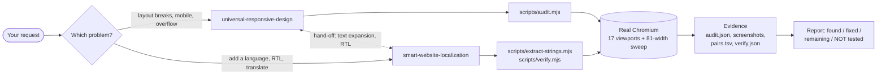

Rule shared by both skills: **no claim without evidence**. If the browser tooling is unavailable, the skill says the result is unverified instead of guessing.

## Install and use

Each skill is a standard directory (`SKILL.md` + `references/` + `scripts/`). Copy it to `~/.claude/skills/` (all projects) or `<project>/.claude/skills/` (one project; this repo already has its own copies in `.claude/skills/`), then start a new Claude Code session.

```bash
cp -r skills/universal-responsive-design skills/smart-website-localization ~/.claude/skills/
npm i -D playwright && npx playwright install chromium     # or: export PLAYWRIGHT_MODULE=/path/to/playwright
```
Requirements: Node 18+ and Playwright with Chromium (used by the bundled scripts).

Invoke by name or just describe the task (both are also triggered by their descriptions):

```
/universal-responsive-design  Make http://localhost:3000 responsive; code is in ./src. Check the nav and the pricing table.
/smart-website-localization   Localize this site into French (vous) and Arabic. Brand names stay Latin. Source in ./src.
```

The scripts also run standalone (options are documented at the top of each file):

```bash
# responsive: audit, fix, then re-audit and diff against the first run
node skills/universal-responsive-design/scripts/audit.mjs --url http://localhost:3000/ --out ./audit/before
node skills/universal-responsive-design/scripts/audit.mjs --url http://localhost:3000/ --out ./audit/after --compare ./audit/before/audit.json

# localization: inventory every string (incl. ones only visible after a click), then verify a localized page
node skills/smart-website-localization/scripts/extract-strings.mjs --url http://localhost:3000/ --source-dir ./src --out strings.json
node skills/smart-website-localization/scripts/verify.mjs --source http://localhost:3000/ --target http://localhost:3000/fr/ --lang fr --out ./l10n-verify
```

---

## Workflow: universal-responsive-design

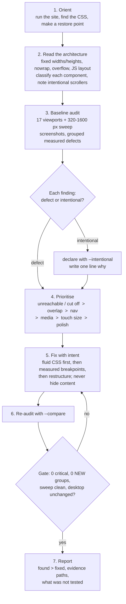

What the audit measures (every item is geometry read from the rendered page):

| Category | Severity | How it is detected |
|---|---|---|
| Horizontal overflow, and overflow *hidden* by `overflow-x:hidden` | critical | `scrollWidth` vs viewport, widest element named |
| Text clipped by `overflow:hidden` | critical | text-box rectangles against the clipping ancestor |
| Offscreen content, overlaps | critical | element and per-line boxes outside scrollers, drawers and decorative layers |
| Distorted images | critical | rendered vs natural aspect ratio with `object-fit` |
| Content that exists on desktop but is unreachable | critical | inventory diff; tries menu toggles and dropdowns before declaring it lost |
| Touch targets | <24 px critical, <44 px major | element or label box |
| Tiny text, fixed layers covering the viewport | major | computed font size, visible area |
| Breakage *between* matrix widths | critical | 81-step sweep reports the failing ranges |

Real output from the benchmark page `r05-tables` (a 12-column table in an `overflow:hidden` card), before the fix, then after:

```text
 CRITICAL clipped-text    td: "Alexandria Montgomery-Whitfield"         (390,1280)
 CRITICAL clipped-text    td: "alexandria.montgomery@example-long-d"    (390,1280)
 ...
# after the fix (table in a scroll container, sticky first column):
No critical issues in the tested viewports.
```
And the regression gate, from another page (`r06-forms`, after a fix): `COMPARE: 2 fixed, 0 NEW, 0 remaining`. A `NEW` line means the last change broke something else and must be reverted or adjusted.

---

## Workflow: smart-website-localization

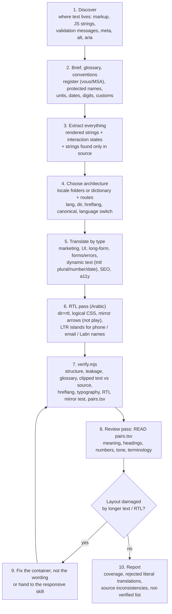

Hard rules that came out of testing: translate meaning and function, not words; **translate the source faithfully and flag inconsistencies instead of silently "fixing" them**; one term, one translation; never concatenate sentence fragments; direction is layout, not alignment; the review is by reading, because no script can detect a wrong meaning.

## Working together

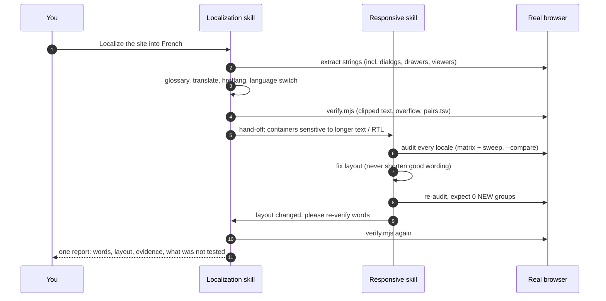

---

## How they were tested

Testing was designed to *expose* weaknesses, not to confirm the skills. Four roles are kept apart, a seeded-defect benchmark gives ground truth, and the cases are split so improvements can be checked on pages the skill never saw.

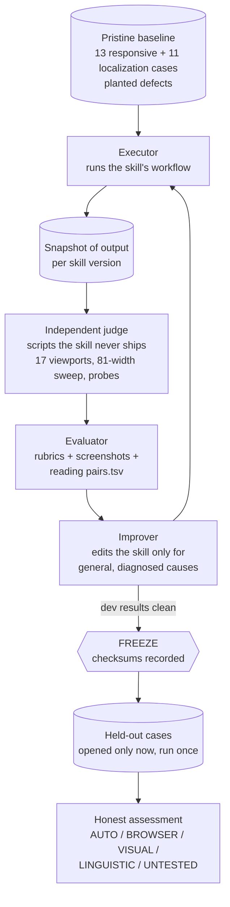

* **Benchmark** (`lab/`): 13 responsive pages and 11 localization pages, each desktop-first or English-only with *planted* defects listed in a manifest; 10 + 9 are development cases, 3 + 2 are held-out.
* **Judges** (`lab/harness/`): separate code from the skills' own scripts, calibrated against negative controls and against every false positive found (about ten classes), then frozen (`*.FROZEN.mjs`). Two known false-positive classes remain and are adjudicated in the reports, not hidden.
* **Real-world case:** a scroll-driven Next.js shop replica, localized to French and made responsive (removed from this tree, see [below](#about-the-real-world-test-site)).
* **Controls:** an untranslated copy tagged `lang="fr"` must be flagged; a compact table must *not* be turned into cards.

## Results

All numbers are from the frozen judge. Raw runs: `lab/results/`. Full analysis: [`docs/06-final-assessment.md`](docs/06-final-assessment.md).

### Responsive: development set (10 cases)

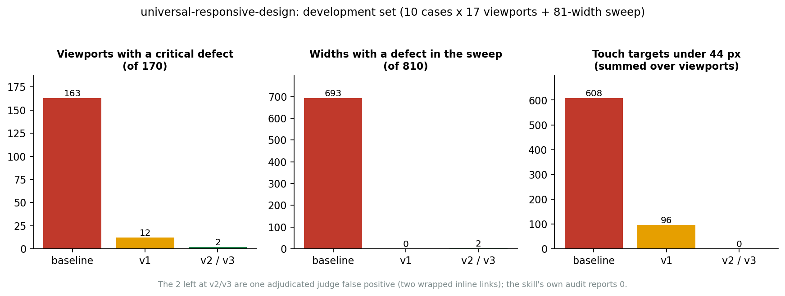

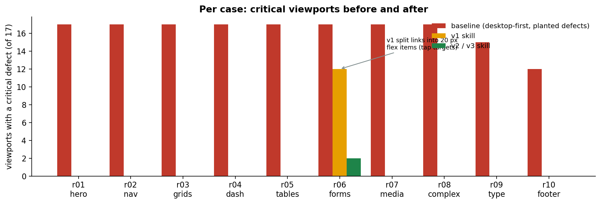

### Responsive: held-out pages (frozen before they were opened)

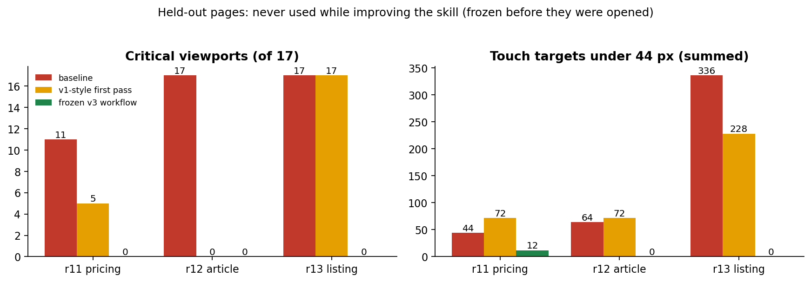

The v1-style first pass left header links, form controls and pagination under 44 px; the frozen workflow's audit listed them and `--compare` reported **0 new defects** on all three pages.

### Real-world site, version by version

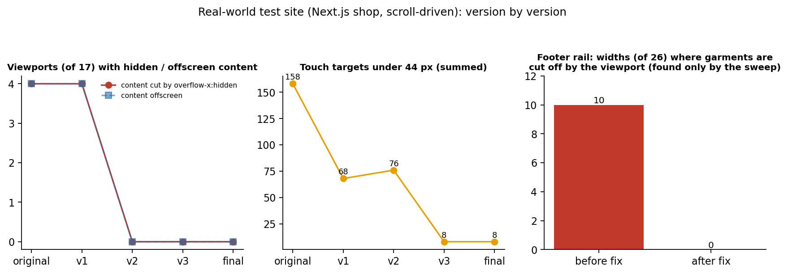

The primary navigation had **no replacement below 760 px** in the original; the footer rail's last two garments were **unreachable at 760-940 px**, visible only through the width sweep (a fixed matrix with 768 and 820 just said "clipped"). Desktop parity was re-checked with a pixel diff: 1440 and 1920 px both pass, every slice at least 99.78 %.

### Localization


The judge found one failure class (French text clipped by fixed-height cards). **The most serious defect was invisible to every script**: a heading "Message counts" had been silently rewritten as "Nombre de fichiers". Only the mandatory read-through of `pairs.tsv` caught it, which is why that step, and the rule "translate the source faithfully, flag inconsistencies", are in the skill.

## Examples of what the skills found

| Skill | Finding | How it was found | Fix |
|---|---|---|---|
| responsive | Table cells silently clipped ("Alexandria Montgo...") at every width | clipped-text on text boxes | scroll container + sticky key column; the compact table left alone |
| responsive | Dashboard sidebar permanently 240 px, page 1440 px wide | overflow + hidden overflow | off-canvas drawer with a real toggle |
| responsive | Nav links vanished on phones with nothing to replace them | unreachable-content inventory | toggle + panel (works by tap and keyboard) |
| responsive | Footer rail cut off only between 760 and 940 px | width sweep | smaller minimum size in that range; measured 10/26 widths bad, then 0/26 |
| responsive | A fix made links 20 px tall by turning a paragraph into flex | `--compare` / named element and size | restore inline flow |
| localization | French text clipped by fixed-height cards | new-vs-source clipped-text check | fluid grid and `min-height` |
| localization | `0 fichier` / `1 fichier`, Arabic 6 plural forms, `1 234,50 $` | probes with counts 0, 1, 2, 5, 11, 101 | `Intl.PluralRules` / `NumberFormat`, a branch per plural category |
| localization | "Voir le Veste de travail" (gender agreement with a `{name}` placeholder) | composed-string review, checked in `pairs.tsv` | per-product article forms, never fragment concatenation |
| localization | Arrows and progress bar not mirrored in RTL | RTL mirror test | logical CSS, mirrored arrows, play icon left alone |
| localization | No `hreflang` on 12 pages | verifier | alternates + language switch |

## How the skills evolved

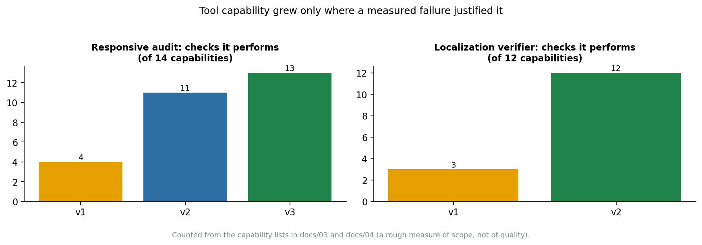

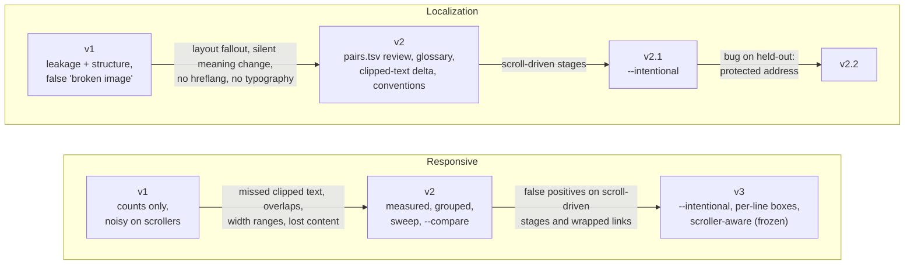

Every change in the skills traces to a measured failure; the version history and checksums are in `lab/skill-versions/`.

## What is not proven

* **Native-speaker quality.** French and Arabic wording was reviewed by the same model family that wrote it; Arabic review is the weaker of the two.
* **Real devices and other browsers.** Chromium only; touch is emulated. No Safari, Firefox, screen readers or real users.
* **Other languages** than French and Arabic; CMS-driven or server-only content; heavy ICU catalog systems.
* **Design taste.** Hierarchy and density are only partly measurable (a rubric and screenshots cover them, for a sample of cases).
* **Shared definitions.** The judge and the skill's audit were written by the same model and share metric definitions, so the judge verifies *fixes*, not the metrics themselves.
* The skills could not be invoked through the Skill tool in the session that built them (skills created mid-session are not discovered); they were run by following `SKILL.md` and its scripts literally.

Details and the adjudicated false positives: [`docs/03`](docs/03-responsive-skill-report.md), [`docs/04`](docs/04-localization-skill-report.md), [`docs/06`](docs/06-final-assessment.md).

---

## Repository layout

```
skills/                        the two skills (canonical source)
  universal-responsive-design/   SKILL.md, references/{strategies,defects}.md, scripts/audit.mjs
  smart-website-localization/    SKILL.md, references/{conventions,french,arabic,rtl}.md,
                                 scripts/{extract-strings,verify}.mjs
.claude/skills/                the same skills, installed for this repo
lab/                           reusable benchmark
  responsive/ l10n/ assets/      working copies of the test pages
  baseline/                      pristine copies (never edited)
  manifest.json, manifest-l10n.json   planted defects, dev/held-out split, expectations
  harness/                       judges (+ *.FROZEN.mjs), runners, compare.mjs
  rubrics/                       visual and linguistic scorecards
  outputs/<version>/             frozen snapshot of each skill version's work
  skill-versions/                every skill version + checksums at the freeze
  results/                       every run: JSON reports, screenshots, summaries
docs/                          strategy, environment, per-skill reports, combined test,
                               final assessment, figures (make_figures.py regenerates them)
```

## Run the benchmark

```bash
node lab/serve.mjs &                                          # http://localhost:4173
export PLAYWRIGHT_MODULE=<path to playwright>
node lab/tools/reset.mjs responsive && node lab/tools/reset.mjs l10n     # restore pristine cases
# run the skill under test on a case, then judge:
node lab/harness/run-responsive.mjs --label mine --split dev              # --split heldout: once, on a frozen version
node lab/harness/run-l10n.mjs       --label mine --split dev
node lab/harness/compare.mjs F-v1 mine                                    # per-case delta, flags regressions
```
More in [`docs/02-benchmark-environment.md`](docs/02-benchmark-environment.md) (all cases, what each stresses) and [`docs/01-TESTING-STRATEGY.md`](docs/01-TESTING-STRATEGY.md) (method). Charts: `python3 docs/figures/make_figures.py`.

## About the real-world test site

The real-world subject was a Next.js replica of a third-party demo shop (built with the Pixel Clone skill). It is **not part of the skills and was removed from the current tree**; it is preserved in git history at commit `2cfc203` (`git checkout 2cfc203 -- hale-site`). Its results remain in `docs/` and `lab/results/` (manifest entries marked `real` are archived and excluded from `--split all`). Some benchmark pages (`lab/assets`) and result screenshots still show imagery from that demo template: replace it before any reuse beyond this evidence repo.

## License

No license file is included yet; add the one you want before publishing for reuse.
