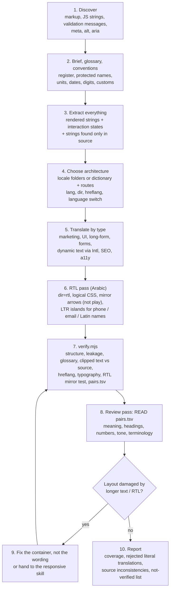
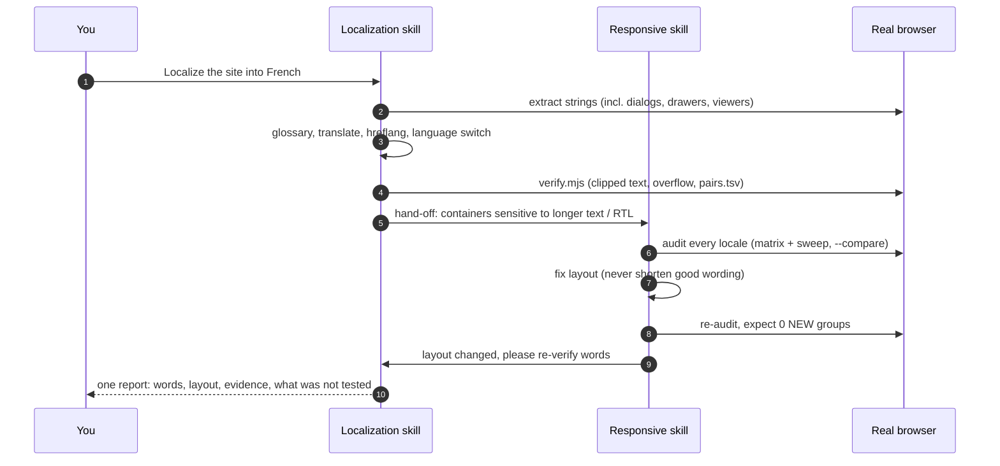
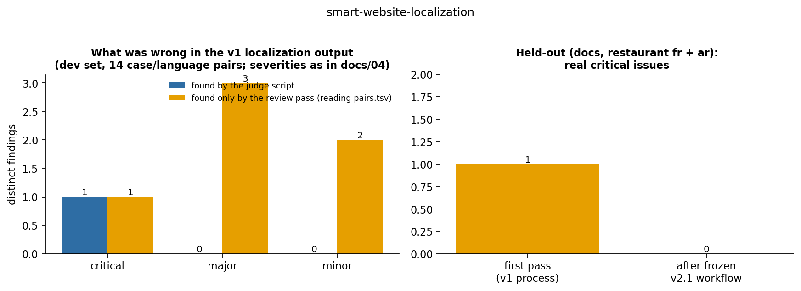

# skill-lang-responsive

**Two portable [Agent Skills](https://agentskills.io) for AI coding agents that work from real browser measurements, not from reading code.**

[](https://github.com/MONTASSAR2001/skill-lang-responsive/actions/workflows/ci.yml)


| Skill | What it does |
|---|---|
| [`universal-responsive-design`](skills/universal-responsive-design) | Audits any existing site across 17 viewports and a 320-1600 px width sweep, finds overflow, clipped text, overlaps, distorted media, tiny touch targets and content that became unreachable, applies a per-component fix strategy, and proves the result with a before/after regression diff. |
| [`smart-website-localization`](skills/smart-website-localization) | Localizes a whole site (tested: French, Arabic/RTL) with context, tone, glossary, locale conventions, plurals/dates/numbers, SEO and accessibility text, hreflang and RTL mirroring, then verifies that longer text or RTL did not break the layout. Includes a mandatory side-by-side review step. |

They are independent: install either one alone, or both. Together, localization owns the **words**, responsive design owns the **layout**, and each re-checks after the other changes anything.

**Contents:** [Install](#install) · [Supported platforms](#supported-platforms) · [Usage](#usage-examples) · [How it works](#how-it-works) · [Evidence](#evidence-that-it-works) · [Repository layout](#repository-layout) · [Docs](#documentation) · [Contributing](#contributing) · [License](#license)

---

## Install

### Claude Code (native plugin marketplace) &nbsp; ✅ verified

```bash
claude plugin marketplace add MONTASSAR2001/skill-lang-responsive
claude plugin install responsive-localization@skill-lang-responsive
```

`responsive-localization` contains both skills. To install just one: `universal-responsive-design@skill-lang-responsive` or `smart-website-localization@skill-lang-responsive`. Then invoke `/responsive-localization:universal-responsive-design` or `/responsive-localization:smart-website-localization`, or just describe your task. Full guide: [docs/install/claude-code.md](docs/install/claude-code.md).

### Every other agent: one command

```bash
git clone https://github.com/MONTASSAR2001/skill-lang-responsive && cd skill-lang-responsive
node scripts/install.mjs --target <claude|agents|cursor|vscode|codex|antigravity|gemini|all> [--scope user|project]
```
The installer (Node 18+, no dependencies) copies the skills to the directory each tool documents. It is idempotent, supports `--dry-run`, `--uninstall`, `--skill <name>`, and never overwrites a directory that is not a skill.

### Requirements for the bundled scripts

Node.js 18+ and Playwright with Chromium in the project you are working on:

```bash
npm i -D playwright && npx playwright install chromium     # or: export PLAYWRIGHT_MODULE=/path/to/playwright
```
Without it the skills still guide the agent, but must report results as unverified.

## Supported platforms

| Platform | Install | Status |
|---|---|---|
| **Claude Code** | Plugin marketplace, or `--target claude` | ✅ **Executed**: Claude Code 2.1.325 (validator, isolated install, discovery of both skills) |
| **Gemini CLI** | `gemini skills install`, or `--target gemini` | ✅ **Executed**: Gemini CLI 0.68.0 (both skills `[Enabled]`) |
| **Cursor** | `--target cursor` or `agents` | 📖 Documented by Cursor; not executed here |
| **VS Code + GitHub Copilot** | `--target vscode` | 📖 Documented; not executed here (vendor docs partly disagree, see matrix) |
| **Google Antigravity** | `--target antigravity` | 📖 Documented; not executed here |
| **OpenAI Codex** | `--target codex` or `agents` | 📖 Documented; not executed here |
| Other clients using `.agents/skills` | `--target agents` | 📖 Convention recommended by the Agent Skills spec |

**✅ Executed** means this repository's automated tests ran the install and discovery against the real tool. **📖 Documented** means the vendor's official documentation describes the location and format and the installer places files there, but the tool was not available to test; nothing here claims more. Details, per-platform differences and sources: [docs/compatibility.md](docs/compatibility.md). Guides: [Claude Code](docs/install/claude-code.md) · [Cursor](docs/install/cursor.md) · [VS Code](docs/install/vscode.md) · [Antigravity](docs/install/antigravity.md) · [Codex](docs/install/codex.md) · [Gemini CLI](docs/install/gemini-cli.md).

## Usage examples

```text
Make http://localhost:3000 responsive. The code is in ./src. Pay special attention to the navigation and the pricing table.
Audit this page at every phone and tablet width and tell me what is broken before changing anything.
Localize this site into French (vous) and Arabic. Brand names stay Latin. Source in ./src, dev server on :3000.
We translated to French last week: re-check that the longer text did not break the layout or the forms.
```

The scripts also run standalone (options are documented at the top of each file; `--help` prints them):

```bash
# responsive: audit, fix, then re-audit and diff against the first run
node skills/universal-responsive-design/scripts/audit.mjs --url http://localhost:3000/ --out ./audit/before
node skills/universal-responsive-design/scripts/audit.mjs --url http://localhost:3000/ --out ./audit/after --compare ./audit/before/audit.json

# localization: inventory every string (including ones only visible after a click), then verify a localized page
node skills/smart-website-localization/scripts/extract-strings.mjs --url http://localhost:3000/ --source-dir ./src --out strings.json
node skills/smart-website-localization/scripts/verify.mjs --source http://localhost:3000/ --target http://localhost:3000/fr/ --lang fr --out ./l10n-verify
```

Real output from the benchmark page `r05-tables` (a 12-column table in an `overflow:hidden` card), before the fix, then after:

```text
 CRITICAL clipped-text    td: "Alexandria Montgomery-Whitfield"         (390,1280)
 CRITICAL clipped-text    td: "alexandria.montgomery@example-long-d"    (390,1280)
 ...
# after the fix (table in a scroll container, sticky first column):
No critical issues in the tested viewports.
```

## How it works


### Responsive design workflow


| What the audit measures | Severity | How |
|---|---|---|
| Overflow, and overflow *hidden* by `overflow-x:hidden` | critical | `scrollWidth` vs viewport, widest element named |
| Text clipped by `overflow:hidden` | critical | text-box rectangles against the clipping ancestor |
| Offscreen content, overlaps | critical | element and per-line boxes outside scrollers, drawers, decorative layers |
| Distorted images | critical | rendered vs natural aspect ratio with `object-fit` |
| Content on desktop but unreachable here | critical | inventory diff; tries menu toggles and dropdowns first |
| Touch targets | <24 px critical, <44 px major | element or label box |
| Tiny text, fixed layers covering the viewport | major | computed size, visible area |
| Breakage *between* matrix widths | critical | 81-step sweep reports failing ranges |

### Localization workflow



Hard rules that came out of testing: translate meaning and function, not words; **translate the source faithfully and flag inconsistencies instead of silently "fixing" them**; one term, one translation; never concatenate sentence fragments; direction is layout, not alignment; the review is by reading, because no script can detect a wrong meaning.

### Working together



## Evidence that it works

The skills were built, tested against a benchmark of planted defects (13 responsive pages, 11 localization pages, split into development and held-out sets), improved from measured failures, **frozen**, and then run once on cases they had never seen. Judges are separate scripts that the skills never ship.




* **Responsive, dev (10 cases):** viewports with a critical defect 163 → 2 (the 2 are an adjudicated judge false positive); touch targets under 44 px 608 → 0.
* **Responsive, held-out (3 unseen pages):** critical viewports 11/17/17 → 0/0/0 after the frozen workflow, with 0 new defects.
* **Localization:** the one failing class (French text clipped by fixed-height cards) fixed; a review pass caught a meaning change that no script can detect; held-out docs and restaurant pages (fr + ar) had no real critical issues after the frozen workflow.
* **Real-world site** (since removed from the tree): primary navigation with no replacement on phones, a footer rail cut off at 760-940 px (found only by the width sweep), hotspot and touch-target defects: all fixed and verified; desktop pixel parity preserved.

**What is not proven:** native-speaker quality (French and Arabic were reviewed by the same model family), real devices, Safari/Firefox, screen readers, other languages. See [docs/evaluation/06-final-assessment.md](docs/evaluation/06-final-assessment.md) for the full, honest assessment and every caveat.

### Quality gates of this repository

`npm test` runs, for real: Agent Skills spec validation (46 checks), plugin and marketplace integrity plus drift against `skills/`, script hygiene, the installer for 7 targets x 2 scopes, 22 real-browser tests (broken vs fixed pages, French good/bad/clipped, Arabic RTL good/unmirrored), Claude Code plugin install and discovery, and Gemini CLI discovery. CI repeats them on Linux, macOS and Windows. Anything a machine cannot run is reported as `SKIP`, never as a pass.

## Repository layout

```
skills/                    Universal Skill Core: the ONLY place skills are edited (Agent Skills standard)
  universal-responsive-design/   SKILL.md, references/{strategies,defects}.md, scripts/audit.mjs
  smart-website-localization/    SKILL.md, references/{conventions,french,arabic,rtl}.md,
                                 scripts/{extract-strings,verify}.mjs
.claude-plugin/marketplace.json  Claude Code marketplace (generated)
plugins/                   three Claude Code plugins (generated from skills/; do not edit)
scripts/install.mjs        cross-agent installer (adapter layer)
tools/                     sync-plugins.mjs (generator + drift check), bump-version.mjs
tests/                     validators, installer, browser, Claude Code and Gemini CLI tests + fixtures
.github/workflows/         ci.yml (Linux/macOS/Windows), release.yml (tag -> GitHub release)
docs/                      compatibility, install guides, architecture, troubleshooting, development,
                           audit, evaluation reports and figures
lab/                       benchmark: planted-defect cases, judges, rubrics, per-version outputs and results
```
Architecture and the reasoning behind generated plugin copies: [docs/architecture.md](docs/architecture.md).

## Documentation

| | |
|---|---|
| [docs/compatibility.md](docs/compatibility.md) | Platform matrix, verification status, sources, known conflicts |
| [docs/install/](docs/install) | Claude Code, Cursor, VS Code, Antigravity, Codex, Gemini CLI |
| [docs/architecture.md](docs/architecture.md) | Layers, single source of truth, data flow |
| [docs/troubleshooting.md](docs/troubleshooting.md) | Symptoms and fixes |
| [docs/development.md](docs/development.md) | Dev setup, tests, adding a skill, versioning, release process |
| [docs/audit.md](docs/audit.md) | Audit of the original repository and what changed |
| [docs/evaluation/](docs/evaluation) | Testing strategy, benchmark, results and evolution of each skill |
| [SECURITY.md](SECURITY.md) | What the scripts do, risks, how to report |
| [CHANGELOG.md](CHANGELOG.md) | Release notes |

## Contributing

Edit skills only in `skills/`, run `npm run sync` and `npm test`, and back behaviour changes with a failing fixture or benchmark case. See [CONTRIBUTING.md](CONTRIBUTING.md) and [docs/development.md](docs/development.md).

## License

[MIT](LICENSE) © 2026 MONTASSAR2001. Some benchmark pages and result screenshots under `lab/` show imagery from a third-party demo template; replace it before reusing that material beyond this evidence repository.
