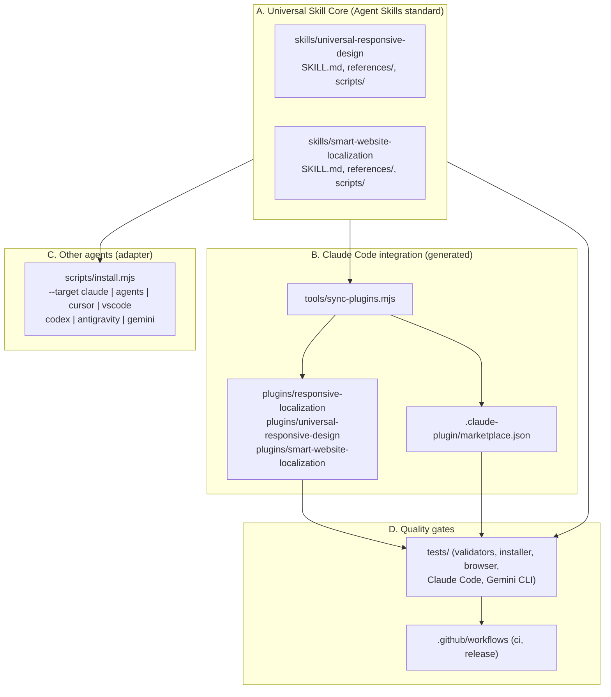

# Architecture

One rule drives the layout: **`skills/` is the only place a skill is edited.** Everything else is generated from it or wraps it.



## Layers

| Layer | Files | Role | Edited by hand? |
|---|---|---|---|
| **A. Core** | `skills/*/SKILL.md`, `references/`, `scripts/` | The skills: instructions, knowledge, browser tooling. Valid per the Agent Skills spec; no platform-specific features | **Yes, only here** |
| **B. Claude Code** | `.claude-plugin/marketplace.json`, `plugins/*` | A marketplace with three plugins (both skills, or each one alone) | **No**: generated by `npm run sync`; CI fails on drift |
| **C. Adapters** | `scripts/install.mjs`, `docs/install/*` | Puts the same files where each tool looks | Yes (small, dependency-free) |
| **D. Gates** | `tests/`, `.github/workflows/` | Spec validation, manifest checks, installer, browsers, real CLIs | Yes |
| **Evidence** | `lab/`, `docs/evaluation/`, `docs/figures/` | The benchmark and results that prove the skills work | Append-only history |

## Why generated copies instead of symlinks

Claude Code installs plugins by copying them into a cache, and a plugin directory must contain its `skills/`. Symlinks would give a single physical copy, but git on Windows without symlink support checks them out as plain text files, which would silently produce an empty plugin. A generated copy plus a CI check (`node tools/sync-plugins.mjs --check`, also part of `tests/validate-plugins.mjs`) gives the same guarantee, a single source of truth, on every OS.

## Skills stay independent

- Each skill folder is self-contained (its own scripts and references; the three scripts share a small bootstrap block that a test keeps identical, instead of importing from each other).
- Each can be installed alone: as a Claude Code plugin of its own, with `install.mjs --skill <name>`, or by copying its folder.
- They cooperate only through documented hand-offs in their `SKILL.md` (text expansion and RTL), never through code.

## Versioning

`package.json` holds the one version. `tools/sync-plugins.mjs` writes it into every `plugin.json` and into `marketplace.json`; `tests/validate-skills.mjs` requires each `SKILL.md` `metadata.version` to match. A mismatch fails the build.

## Data flow of a skill run

```mermaid
sequenceDiagram
  participant U as You
  participant A as Agent (any supported tool)
  participant S as SKILL.md + references
  participant X as scripts/*.mjs
  participant B as Chromium (Playwright)
  U->>A: "make this responsive" / "localize to French"
  A->>S: skill matched by its description; instructions loaded
  A->>X: run audit / extract / verify (shell)
  X->>B: open your URL, measure, screenshot
  B-->>X: geometry, text, screenshots
  X-->>A: audit.json, pairs.tsv, grouped findings
  A->>A: fix, re-run with --compare, review
  A-->>U: report: found / fixed / remaining / not tested
```
